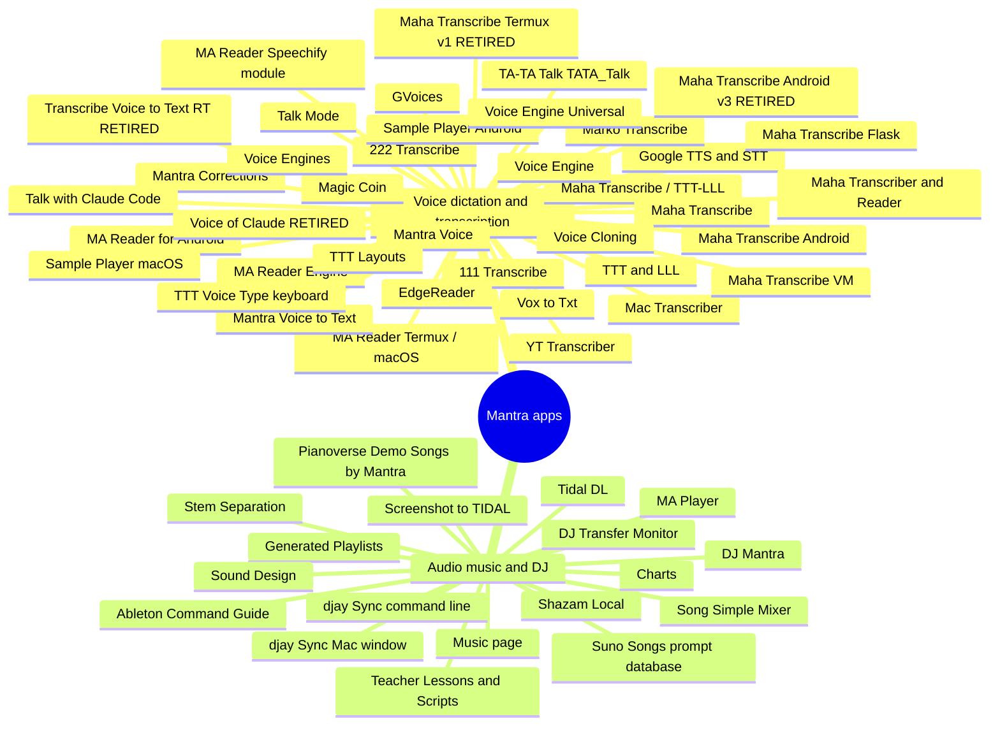
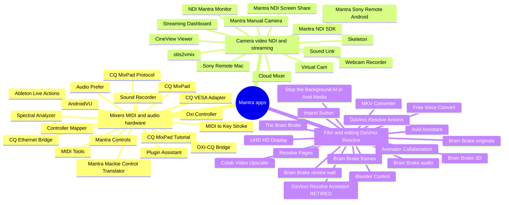
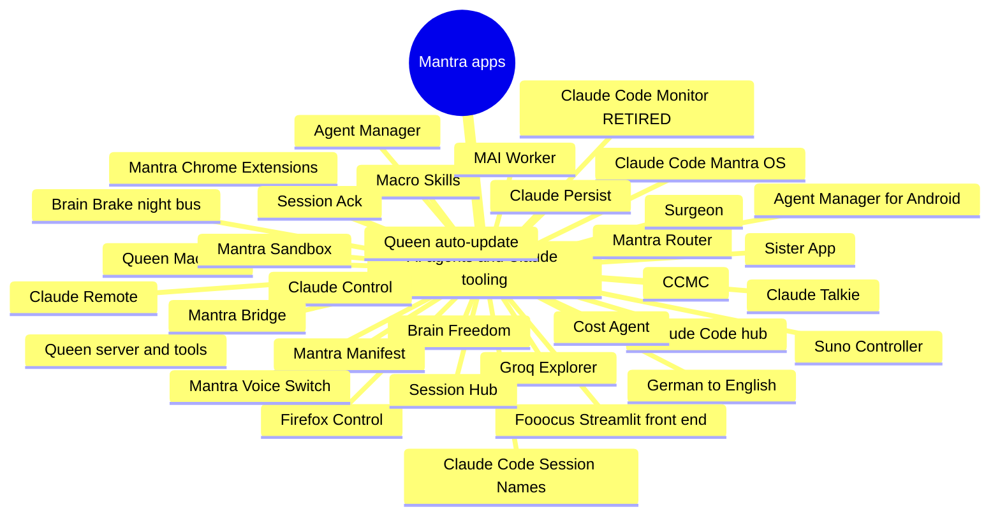
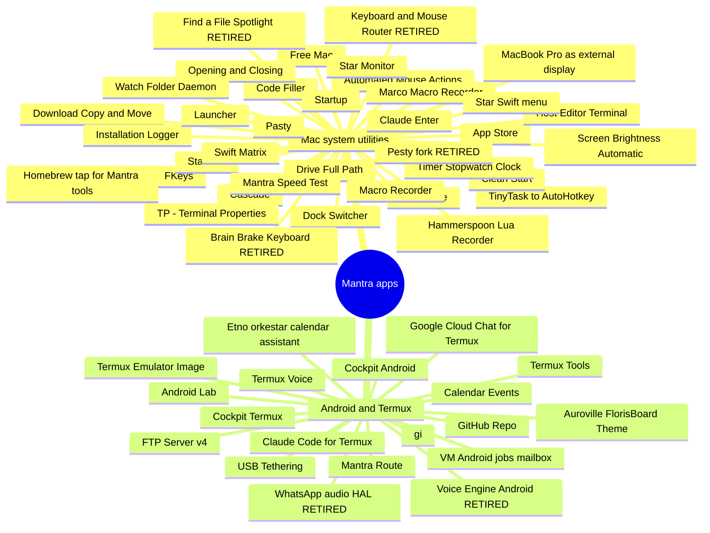
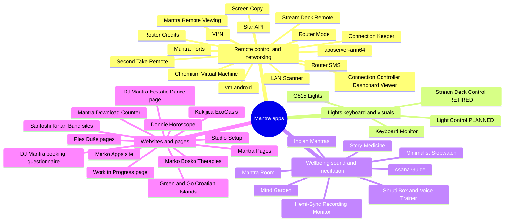
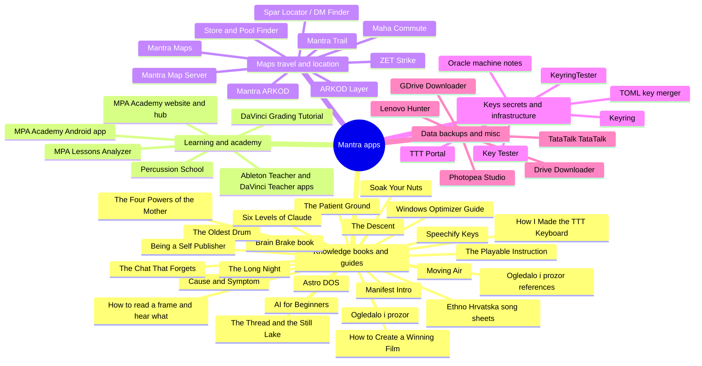

# Mind map of everything

The brain as pictures first, then as an outline. Every leaf is an app or tool on this map; the outline links to its card. Planned apps are marked PLANNED, retired apps RETIRED.

## Diagram 1

## Diagram 2

## Diagram 3

## Diagram 4

## Diagram 5

## Diagram 6

## Outline

### Voice, dictation and transcription

- [111 Transcribe](apps/111-transcribe.md) - Streamlit web app: upload audio or video, get a transcript with speakers, timecodes, subtitles and translation through AssemblyAI.
- [222 Transcribe](apps/222-transcribe.md) - Streamlit web app: upload or record audio/video, get a transcript with speakers, timecodes, subtitles and translation via AssemblyAI. Copy of 111 Transcribe.
- [EdgeReader (MA Reader Streamlit)](apps/mareader.md) (`mareader`) - Streamlit text-to-speech reader: paste text, pick an Edge neural voice, words highlight in time; plus a speech-to-speech translate tab.
- [Google TTS and STT (gtt)](apps/GOOGLE_TTS_STT.md) (`GOOGLE_TTS_STT`) - One local app for Gemini text-to-speech and speech-to-text on one shared free-tier key ring: thirty voices, two speakers, transcription, key tests.
- [GVoices (Google Voices)](apps/GoogleVoices.md) (`GoogleVoices`) - Local page for Google's thirty prebuilt Gemini voices: a sentence in, a WAV out, archive of everything said, and a key ring manager. Command gvoice.
- [MA Reader Engine](apps/MA_READER_ENGINE.md) - Shared Kotlin library: Microsoft Edge speech WebSocket client with word boundaries, plus word-timing alignment; used by TTT's LLL reader and MA Reader Android.
- [MA Reader for Android](apps/MA_READER_ANDROID.md) (`MA_READER_ANDROID`) - Android port of the MA Reader screen (paste text, sentence split, library, voice list) that does not speak yet; the voice client is not built.
- [MA Reader Speechify module](apps/MA_READER_SPEECHIFY.md) (`MA_READER_SPEECHIFY`) - Termux read-aloud web app (MA Reader v34) with Edge and Speechify voices, plus a reusable Speechify key ring, key parser and API guide.
- [MA Reader Termux / macOS (Edge / Speechify)](apps/MA_READER_TERMUX_MACOS.md) (`MA_READER_TERMUX_MACOS`) - Single-file installer for a browser reader on Termux or macOS that speaks text aloud and lights each word, with Edge and Speechify voices and a key ring.
- [Mac Transcriber (scribe)](apps/MAC_TRANSCRIBER.md) (`MAC_TRANSCRIBER`) - Command scribe: transcribe a YouTube URL or audio file with Groq, AssemblyAI or Deepgram, chunked at silences, with key rotation and timestamps.
- [Magic Coin](apps/magic-coin.md) - Mac floating white ring: MA face transcribes speech, BA face reads aloud the text underneath it; clicks pass through the hole.
- [Maha Transcribe (Termux/terminal)](apps/MAHA_TRANSCRIBE_TERMUX_TERMINAL.md) - Runs the Maha Transcribe HTML page from a small Flask server on Termux, macOS or Linux, as one shell command 'transcribe', with port fallback.
- [Maha Transcribe / TTT-LLL (Streamlit)](apps/MAHA_TRANSCRIBE_STREAMLIT.md) (`MAHA_TRANSCRIBE_STREAMLIT`) - Streamlit web app: record in the browser, ffmpeg downsample, Whisper on Groq to text (EN/HR), plus Talk tab that reads text aloud sentence by sentence.
- [Maha Transcribe Android (native)](apps/MAHA_TRANSCRIBE_ANDROID_2.md) (`MAHA_TRANSCRIBE_ANDROID_2`) - Native Kotlin/Compose rewrite of Maha Transcribe for Android; version 1 is the T (talk to type) screen only, built for a dyslexic, low-vision user.
- [Maha Transcribe Flask](apps/MAHA_TRANSCRIBE_FLASK.md) - Flask app in an Avid-style look: record or upload audio, transcribe live, read text aloud with word highlighting, keep notes with quotas; one shared login.
- [Maha Transcribe VM (TTT-LLL)](apps/MAHA_TRANSCRIBE_VM.md) (`MAHA_TRANSCRIBE_VM`) - Streamlit app on the VM: record voice, transcribe with Groq Whisper, read text aloud sentence by sentence; TTT-LLL moved off Streamlit Cloud.
- [Maha Transcriber and Reader (web)](apps/maha-transcriber-reader.md) (`maha-transcriber-reader`) - One web page for speech-to-text and text-to-speech with word highlighting; eight voice providers; API keys stay on the device.
- [Mantra Corrections](apps/MANTRA_CORRECTIONS.md) - Shared correction database for the dictation and typing tools: curated replacement pairs plus what each device learned. Data only, builds nothing.
- [Mantra Voice (speech server)](apps/MANTRA_VOICE.md) (`MANTRA_VOICE`) - The system-wide local speech server: Whisper listening, cloned-voice speaking with word timings, a Voices page, and a READ button script for any page.
- [Mantra Voice to Text (downloads)](apps/mantra-voice-to-text-downloads.md) - Release-files-only repo for Mantra Voice to Text, free offline Whisper dictation for Mac and Windows (press F1, talk, press F1).
- [Marko Transcribe (Streamlit)](apps/marko-transcribe.md) (`marko-transcribe`) - Streamlit web transcriber that sends audio to AssemblyAI with a rotating ring of keys, ffmpeg handling and results logged to Google Sheets (v3.16).
- [Sample Player, Android](apps/SAMPLE_PLAYER.md) (`SAMPLE_PLAYER`) - Android app that records 30 spoken phrases per project, transcribes them, replaces the voice and plays the set with a travelling playhead.
- [Sample Player, macOS](apps/SAMPLE_PLAYER_MACOS.md) - Local Flask server with a web page for macOS: the same recorded cells, transcription and voice replacement as the Android app SAMPLE_PLAYER.
- [TA-TA Talk (Croatian dictation)](apps/TATA_Talk.md) (`TATA_Talk`) - Simple Croatian speech-to-text Android app: press, speak, text appears and is copied, with a notes list and custom keyboard.
- [Talk Mode (Mantra)](apps/TALK_MODE.md) (`TALK_MODE`) - Mac app for talking with Claude Code sessions by voice: listens, transcribes, types into a chosen iTerm2 or VM session and reads the reply aloud.
- [Talk with Claude Code](apps/TALK_WITH_CLAUDE.md) (`TALK_WITH_CLAUDE`) - Local web page where you press TALK, speak, and Claude answers in text and in the cloned voice with sentence and word highlighted.
- [TTT Layouts](apps/ttt-layouts.md) - Keyboard rows and key colours (profile-Marko-layout.jetpref) for TTT Talk to Type, the Android voice-dictation keyboard; no prompts or keys.
- [TTT Voice Type keyboard](apps/TTT.md) (`TTT`) - Android voice-typing keyboard (Talk to Type): dictate into any text field with cloud or offline engines, with an RE reply assistant and an adb remote API. Fork
- [TTT&LLL (Talk to Type, Look Listen Learn)](apps/DictateKeyboard.md) (`DictateKeyboard`) - Android voice keyboard (fork of Dictate on FlorisBoard): dictate with AssemblyAI, Gemini, Anthropic or offline Whisper and Parakeet, plus an AI reader.
- [Voice Cloning (Mantra)](apps/VOICE_CLONING.md) (`VOICE_CLONING`) - Mac window to clone a voice from a file or the microphone, choose which voice talks and test every voice, over the MANTRA_VOICE API.
- [Voice Engine (Mantra)](apps/VOICE_ENGINE.md) (`VOICE_ENGINE`) - Mac app that draws the subtitle band while Claude's voice speaks, with pause, stop and replay, and holds the global voice on/off switch (voiceengine).
- [Voice Engine Universal (Mantra)](apps/VOICE_ENGINE_UNIVERSAL.md) (`VOICE_ENGINE_UNIVERSAL`) - Shared pause, continue and word-timing rules for the subtitle that follows the voice, in Swift and Kotlin, used as a submodule by the voice apps.
- [Voice Engines (model hub)](apps/VOICE_ENGINES.md) (`VOICE_ENGINES`) - Central registry and fetch command for the local speech and listening models used by the voice server; weights are not in git.
- [Vox to Txt (Mantra)](apps/MANTRA_VOICE_TO_TEXT.md) (`MANTRA_VOICE_TO_TEXT`) - Mac and Windows dictation app: press F1, talk, press F1, and the words are typed at the cursor. Many engines, Whisper offline, corrections, file transcription,
- [YT Transcriber](apps/YT_TRANSCRIBER.md) - Turns a YouTube channel, playlist or video URL into one transcript file, one video at a time via Groq Whisper, with an optional knowledge summary.
- [Maha Transcribe Android v3 (web view, superseded) (retired)](apps/MAHA_TRANSCRIBE_ANDROID.md) (`MAHA_TRANSCRIBE_ANDROID`) - Maha Transcribe v3 for Android with the web UI in a WebView on an on-device server; superseded by the native MAHA_TRANSCRIBE_ANDROID_2.
- [Maha Transcribe Termux v1 (superseded) (retired)](apps/MAHA_TRANSCRIBE_TERMUX.md) (`MAHA_TRANSCRIBE_TERMUX`) - One-file Termux installer for a store-first voice transcription app: Flask + Waitress + SQLite, terminal dashboard, multi-provider keys.
- [Transcribe Voice to Text RT (Mantra) (retired)](apps/MARKO_TRANSCRIBE.md) (`MARKO_TRANSCRIBE`) - Floating Mac dictation stripe: press F1, speak, it transcribes (Whisper local or Groq), optionally cleans the text with an LLM, and types it at the cursor.
- [Voice of Claude (Mantra) (retired)](apps/VOICE_OF_CLAUDE.md) (`VOICE_OF_CLAUDE`) - Mac window with one switch to start or stop the whole voice engine (door, ears, cloned voice) and remember the choice.

### Audio, music and DJ

- [Ableton Command Guide](apps/ABLETON_COMMAND_GUIDE.md) - Local voice chat page that answers shortcut questions about Ableton Live and performs spoken orders in Live over AbletonOSC.
- [Charts](apps/charts.md) - Turns a BeatStats chart PDF into a Spotify playlist, reading the pages with Gemini and searching Spotify.
- [DJ Mantra (Android DJ app)](apps/djmantra_app.md) (`djmantra_app`) - Android DJ app built on the Mixxx 2.5.6 engine for the Hercules DJControl Mix Ultra: two decks, USB-stick library, beat lights, test builds.
- [DJ Transfer Monitor (Mantra)](apps/DJ_TRANSFER_MONITOR.md) (`DJ_TRANSFER_MONITOR`) - Small read-only Mac window that shows the live progress of a djay playlist transfer to the phone: file, bars, speed, ETA, skipped files and last error.
- [djay Sync (Mantra), Mac window](apps/DJING_SYNC.md) (`DJING_SYNC`) - Swift Mac window (djay Sync (Mantra)) that syncs djay Pro playlists to the DJ phone app and pulls phone ones back as .m3u8; logic is in djay-playlists.
- [djay Sync, command line (djay-sync)](apps/djay-playlists.md) (`djay-playlists`) - Command djay-sync copies djay Pro playlists from the Mac to the Pixel for DJ Mantra over adb, one way, differences only; its Mac window is DJING_SYNC.
- [Generated Playlists](apps/generated_playlists.md) - Repo where Claude continues reference songs into same-style playlists as text files and creates them on Marko's TIDAL account, named '(generated)'.
- [MA Player](apps/ma-player.md) - Terminal music player for Termux with a browser front end and a downloader for TIDAL and YouTube, driving mpv.
- [Music page](apps/music.md) (`music`) - Single index.html music page; purpose not documented.
- [Pianoverse Demo Songs by Mantra](apps/PIANOVERSE_DEMO_SONGS.md) (`PIANOVERSE_DEMO_SONGS`) - Scripts that build an Ableton Live set of 108 classical piano pieces, one minute each, from MIDI performances.
- [Screenshot to TIDAL (Mantra)](apps/SCREENSHOT_TO_TIDAL.md) (`SCREENSHOT_TO_TIDAL`) - Reads a chart or tracklist screenshot with on-device OCR and builds a TIDAL playlist; also copies djay Pro playlists to TIDAL.
- [Shazam Local](apps/SHAZAM_LOCAL.md) - Offline song and recording recognition in one Python file: landmark matching for same-recording offsets and chroma matching for songs across concerts.
- [Song Simple Mixer](apps/Song_simple_mixer.md) - Android app: one vocal, one backing track, two faders, nudge and 'vocal space' ducking, exports the mix as a WAV.
- [Sound Design](apps/SOUND_DESIGN.md) - Sound department workspace for a short film: a cue sheet derived from the film data, sound tools and method notes.
- [Stem Separation (Mantra)](apps/STEM_SEPARATION.md) (`STEM_SEPARATION`) - Mac app that has Ableton Live 12 split a song into vocal, bass, drums and other stems, collects the files and analyses each stem.
- [Suno Songs prompt database](apps/SUNO_SONGS.md) (`SUNO_SONGS`) - Tagged database of reusable Suno style and lyrics prompts with a menu script and a Chromium extension that drives suno.com from a local CLI.
- [Teacher Lessons and Scripts (Ableton, DaVinci)](apps/ABLETON_TEACHER.md) (`ABLETON_TEACHER`) - Private command-line side of the two Teachers: lesson history, live.py (Ableton via AbletonOSC), resolve.py (DaVinci Resolve) and teacher.py.
- [Tidal DL](apps/tidal_dl.md) - Terminal tool (Mac Apple Silicon and Termux) that downloads TIDAL albums, tracks, playlists and artists with streamrip and checks FLAC with ffprobe.

### Mixers, MIDI and audio hardware

- [Ableton Live Actions (Mantra)](apps/ABLETON_LIVE_ACTIONS.md) (`ABLETON_LIVE_ACTIONS`) - One Mac app that fits Ableton Live to Marko's hands: A1 assistant, MIDI-to-Mackie, MIDI-to-keystroke, CQ-12T channel macros, audio sync.
- [AndroidVU](apps/ANDROIDVU.md) - Android probe for per-stream audio levels (call, media, ring, notification, alarm); meant to become five hairline VU meters as an overlay. v1 draws no meters.
- [Audio Prefer](apps/audio-prefer.md) - Background helper that makes the Mac's audio output follow a fixed order: the CQ12T mixer, then ADAM monitors, then the built-in speakers.
- [Controller Mapper (Mantra)](apps/mix-ultra-mapper.md) (`mix-ultra-mapper`) - Mac app that maps any USB MIDI controller by guiding the owner through every control, lighting its LEDs, and saves a capture JSON.
- [CQ Ethernet Bridge](apps/CQ_ETHERNET_BRIDGE.md) - Recipe, not code: control an Allen & Heath CQ-12T from CQ MixPad on a Pixel phone over a USB-LAN cable using Android Ethernet tethering.
- [CQ MixPad (Mantra)](apps/CQ_MIXPAD_MANTRA.md) - Android remote for the Allen & Heath CQ-12T built on its decoded private protocol: faders, PEQ, comp, RTA, record, reference matching, three layouts.
- [CQ MixPad Protocol](apps/cq_mixpad_protocol.md) - Public database of the decoded private network protocol of Allen & Heath CQ mixers (CQ-12T), plus sniffer and injector tools.
- [CQ MixPad Tutorial (Mantra)](apps/cq_mixpad_tutorial.md) (`cq_mixpad_tutorial`) - Offline Swift tutorial app that teaches the Allen & Heath CQ-12T by voice, diagrams and an on-screen hand that clicks CQ MixPad and Live.
- [CQ VESA Adapter](apps/cq_vesa_adapter.md) - Design of a plate adapter that mounts the Allen & Heath CQ-12T on a VESA 75/100 arm or tripod head; 3D model and 1:1 drawings.
- [Mantra Controls (MIDI to Key Stroke / MIDI to MK Control)](apps/MANTRA_CONTROLS.md) (`MANTRA_CONTROLS`) - Two small Mac windows that control the MIDI to Key Stroke and MIDI to MK Control engines over their local HTTP state/do servers.
- [Mantra Mackie Control Translator](apps/mantra-mackie-control-translator.md) - Hammerspoon module that translates OXI E16 MIDI knobs and notes into Mackie Control so Ableton Live's arrangement timeline can sit under a knob.
- [MIDI to Key Stroke](apps/MIDI_TO_KEYSTROKE.md) - Turns a MIDI controller knob into a key press or the Mac volume through a CC/value/key table with detect and learn.
- [MIDI Tools (Mantra)](apps/MANTRA_MIDI_TOOLS.md) (`MANTRA_MIDI_TOOLS`) - Mac menu-bar app with two MIDI tools: MIDI to MK Control (knobs and keys to Ableton Mackie commands) and MIDI to Key Stroke (notes and CC to key strokes).
- [Oxi Controller (E16 Remote)](apps/oxi-controller.md) (`oxi-controller`) - Mac app that turns the OXI E16 knob controller into a remote for Ableton Live (via AbletonOSC) or DaVinci Resolve audio, with a drawn screen.
- [OXI-CQ Bridge](apps/oxi_e16_cq-12t.md) (`oxi_e16_cq-12t`) - Python bridge that controls an Allen & Heath CQ-12T mixer from an OXI E16 knob controller via MIDI/NRPN, with a local web UI and a virtual E16.
- [Plugin Assistant](apps/PLUGIN_ASSISTANT.md) - Mac rack of Audio Unit effects for the microphone (output to BlackHole) plus a Chrome extension that swaps the browser mic for it; local HTTP API.
- [Sound Recorder (Mantra)](apps/MANTRA_SOUND_RECORDER.md) (`MANTRA_SOUND_RECORDER`) - Mac recorder with input/output VU meters in dB, take waveforms, WAV save, and recording of one app's sound (Chrome, Suno) through a process tap.
- [Spectral Analyzer (Mantra)](apps/SPECTRAL_ANALYZER.md) (`SPECTRAL_ANALYZER`) - Mac audio analyzer: live spectrum, EBU R128 loudness, stereo scopes, click/plosive/sibilance finder, piano keyboard for pitch, and a JSON command line.

### Camera, video, NDI and streaming

- [CineView Viewer](apps/CINEVIEW_VIEWER.md) - Swift Mac viewer that shows the picture of an Accsoon CineView Nano over its own Wi-Fi. Protocol implemented but not working against the Nano yet.
- [Cloud Mixer](apps/CLOUD_MIXER.md) - Programmatic vision mixer on chromium-vm: mixes files, stills, colours and live URLs into one program and publishes it to the relay for the site's live player.
- [Mantra Manual Camera](apps/mantra-manual-camera.md) - Android manual-control cinema camera app: ISO/shutter/focus/WB faders, log curves, 10-bit HEVC, NDI and VDO.Ninja live out, Sony REC and timecode, adb-driven.
- [Mantra NDI Screen Share (Android)](apps/mantra-ndi-screen-share-android.md) - Android app that sends the phone screen onto the network as an NDI source (compressed HX or full NDI), turning with the phone.
- [Mantra NDI SDK (private vendor files)](apps/mantra-ndi-sdk.md) (`mantra-ndi-sdk`) - Private store of the licensed NDI Advanced SDK for Android (arm64) that the mantra-ndi build fetches in CI.
- [Mantra Sony Remote (TC Jam), Android](apps/sony_remote_controller.md) (`sony_remote_controller`) - Android app that jams time code into Sony Alpha cameras over USB, starts REC on all Sonys over Bluetooth, outputs LTC; Mac counterpart: SONY_REMOTE_MAC.
- [NDI Mantra Monitor](apps/ndi-mantra-monitor.md) - NDI receiver for the Mac: one window, one picture, right-click to choose a source.
- [obs2vmix](apps/obs2vmix.md) - Fork of OBS Studio for Mac (Apple Silicon) that re-skins OBS as a vMix-style switcher: Studio Mode only, two monitors, five thumbnails, right-click actions.
- [Skeleton (Mantra)](apps/SKELETON.md) (`SKELETON`) - Mac app that follows a person with a body-pose skeleton from any chosen camera, scores matches to target poses, and takes Pixel phones with Manual Camera.
- [Sony Remote (Mantra), Mac](apps/SONY_REMOTE_MAC.md) (`SONY_REMOTE_MAC`) - Mac app and local door that connects to a Sony camera and starts or stops REC on its card; the Android counterpart is sony_remote_controller.
- [Sound Link (Mantra)](apps/SOUND_LINK.md) (`SOUND_LINK`) - Mac app that sends stereo sound (e.g. from an XLR mixer) over Wi-Fi to the Manual Camera Android app; includes a Studio encoder that pairs NDI video with mixer
- [Streaming Dashboard (Mantra)](apps/STREAMING_DASHBOARD.md) (`STREAMING_DASHBOARD`) - Mac app and VM web service showing the live-stream chain (phone, Mac, VM, site) with rates, viewers and start or go-live buttons for the Meditation Room.
- [Virtual Cam (Mantra)](apps/mantra_virtual_cam.md) (`mantra_virtual_cam`) - Mac app that makes the phone's Mantra Manual Camera the Mac's webcam over USB or Wi-Fi, with its interface shown in a window and clickable.
- [Webcam Recorder (Mantra)](apps/web-cam-viewer.md) (`web-cam-viewer`) - Mac app that shows any camera the Mac sees (webcam, capture card, NDI/virtual cams, Sony over USB) with sound meters and one-key crash-safe MKV recording.

### Film and editing (DaVinci Resolve)

- [Animator Collaboration](apps/ANIMATOR_COLLABORATION.md) - Storage and handover site for the Brain Brake animation: scene-by-scene frame variations, backgrounds and foregrounds for the animator.
- [Avid Assistant](apps/AVID_ASSISTANT.md) - AutoHotkey v2 suite for a Windows edit suite around Avid Media Composer: macros, window handling, monitor setup.
- [Blender Control](apps/blender-control.md) - Controls a live open Blender 5.2 GUI (or headless Blender) from outside over a localhost TCP JSON-RPC bridge and a CLI; includes procedural 3D test projects.
- [Brain Brake 3D](apps/BRAIN_BRAKE_3D.md) - Blender scripts that model the film's brass key in plain Python and render brass and drawn-paper stills headless.
- [Brain Brake audio](apps/BRAINBREAK_AUDIO.md) (`BRAINBREAK_AUDIO`) - Every sound of the Brain Brake film: voice takes, radio drama in English and Croatian, theme song, end credits, with waveform peaks.
- [Brain Brake frames](apps/BRAIN_BRAKE_FRAMES.md) - Contact sheet of every frame of The Brain Brake and the reference sheet, as one static page with thumbnails.
- [Brain Brake originals](apps/BRAIN_BRAKE_ORIGINALS.md) - Full-resolution stills of the film, scene folders BB_C_0 to BB_C_8, public with no Pages site so raw links work without credentials. About 2.8 GB.
- [Brain Brake review wall](apps/BRAIN_BRAKE_REVIEW.md) (`BRAIN_BRAKE_REVIEW`) - Local full-screen page that shows each new frame from the chat session and sends KEEP or REDO verdicts back with no typing.
- [Colab Video Upscaler](apps/colab-video-upscaler.md) - Free Topaz stand-in: restores Resolve clips with CodeFormer and Real-ESRGAN on Colab's free GPU in chunks through Google Drive.
- [DaVinci Resolve Actions (Mantra)](apps/DAVINCI_RESOLVE_ACTIONS.md) (`DAVINCI_RESOLVE_ACTIONS`) - Mac app with ACTIONS and MODS tabs for DaVinci Resolve, plus resolve_router.py, the one door every app and session uses to reach Resolve's scripting API.
- [Free Voice Convert (Equalizer)](apps/FREE_VOICE_CONVERT.md) (`FREE_VOICE_CONVERT`) - Makes AI-video voices sound the same: cleans, converts speech to a chosen voice profile with Seed-VC, matches the room sound and levels, lossless export.
- [Import Button (Mantra)](apps/IMPORT_BUTTON.md) (`IMPORT_BUTTON`) - Mac helper that turns the mouse thumb button into Command-I (Import Media) while DaVinci Resolve is in front.
- [MKV Converter (MPA)](apps/MKV_CONVERTER.md) (`MKV_CONVERTER`) - Repacks browser-recorded lesson MKV/WebM files into Resolve-ready MOV with time code, via a Mac app and a Resolve script.
- [Resolve Pages (Mantra)](apps/RESOLVE_PAGES.md) (`RESOLVE_PAGES`) - Command-Tab style switcher for DaVinci Resolve pages: hold Option and tap backtick to cycle the page ring.
- [Stop the Background AI in Avid Media Composer](apps/AVID_BACKGROUND.md) (`AVID_BACKGROUND`) - One-page guide with a PDF on how to stop Avid Media Composer's background AI transcription, indexing and render services.
- [The Brain Brake (film repository)](apps/BRAIN_BRAKE.md) (`BRAIN_BRAKE`) - Main repository of the film The Brain Brake: scripts, handover, memory, prompts, scene packages, PDF and site builders. About 1.9 GB.
- [UHD HD Display (Mantra)](apps/UHD_HD_DISPLAY.md) (`UHD_HD_DISPLAY`) - Shows DaVinci Resolve's HD or UHD project mode as a word in the menu bar; a click or hotkey toggles it via a Resolve script.
- [DaVinci Resolve Assistant (retired)](apps/DAVINCI_RESOLVE_ASSISTANT.md) - Older set of Resolve menu scripts (Toggle HD UHD, Previous Page, Create Timeline) with a self-check and the star menu's UHD/HD badge and page turner.

### AI agents and Claude tooling

- [Agent Manager (CEO) (Mantra)](apps/AGENT_MANAGER.md) (`AGENT_MANAGER`) - Mac window and phone door showing every running Claude Code session, agent, worker and blocker across the Mac, chromium-vm and phones.
- [Agent Manager (CEO) (Mantra) for Android](apps/AGENT_MANAGER_ANDROID.md) (`AGENT_MANAGER_ANDROID`) - Phone view of the Agent Manager: usage, running agents, blockers with SOLVE/DONE, plan cards, and PAUSE/STOP/MESSAGE per task, over Tailscale.
- [Brain Brake night bus](apps/BRAINBREAK_BUS.md) (`BRAINBREAK_BUS`) - Append-only JSONL message bus between a Claude chat session and Claude Code on the Mac, plus chatlink.py to read and send in the claude.ai tab.
- [Brain Freedom](apps/BRAIN_FREEDOM.md) - Split-screen studio for making a film by voice: left brain speaks and shows frames, right brain is a real terminal running the coding agent.
- [CCMC (MANTRA CHAT, the sister of Claude Code)](apps/CCMC.md) (`CCMC`) - Local chat page that mirrors every Claude Code session as cards, reads answers aloud with Speechify, takes voice and typed input back into the session.
- [Claude Code hub](apps/claude-code.md) (`claude-code`) - Hub repo: journal of every Claude Code session, handover of every project, code index, and every program as a git submodule.
- [Claude Code Mantra OS](apps/claude-code-mantra-os.md) - Method and templates for running Claude Code as a master session with parallel child agents, cheap model routing and skills; documents only, no code.
- [Claude Code Session Names](apps/claude-code-session-names.md) - Claude Code SessionStart hook/plugin that names each session by place, day counter and date, e.g. mac1_14-11, pixel1_15-11, cloud7k_14-11.
- [Claude Control (Mantra)](apps/CLAUDE_CONTROL.md) (`CLAUDE_CONTROL`) - Menu-bar play/pause for everything Claude Code runs on the Mac: stops Claude process trees and tools, resumes them, shows RUNNING or PAUSED.
- [Claude Persist](apps/claude-persist.md) - Resumes a Claude Code session that stopped on an API error every 10 seconds, and restarts it when the quota resets.
- [Claude Remote (Mantra)](apps/CLAUDE_REMOTE.md) (`CLAUDE_REMOTE`) - Claude Code mod that draws one status line under the prompt: router, model, session and week usage, skill, context, remote control, voice, permission mode.
- [Claude Talkie](apps/Claude_Toki.md) (`Claude_Toki`) - Flask web skin over Claude with microphone input, streamed answers read aloud with word highlighting, a daily quota and one shared login.
- [Cost Agent (Mantra)](apps/COST_AGENT.md) (`COST_AGENT`) - Gate that asks Marko YES or NO with the dollar estimate before any paid API call (Groq, images, Speechify above allowance) and keeps spending ledgers.
- [Firefox Control](apps/firefox-control.md) - firefoxctl: lets Claude Code drive Marko's own running Firefox through WebDriver BiDi with text in, text out, no screenshots.
- [Fooocus Streamlit front end](apps/marko-fooocus.md) (`marko-fooocus`) - Streamlit front end with a Google Colab notebook backend for Fooocus image generation (early experiment).
- [German to English (Mantra)](apps/GERMAN_TO_ENGLISH.md) (`GERMAN_TO_ENGLISH`) - Firefox extension that translates German web pages to English in place with Claude Haiku, with a one-click switch back to the German.
- [Groq Explorer](apps/GROQ_EXPLORER.md) - Android playground for every Groq model: a tile deck built from the models list, each opening the right interface and showing the exact request and a curl.
- [Macro Skills](apps/MACRO_SKILLS.md) - Catalogue of Mac actions the Macro Recorder already knows; any app or session asks it first with macroskill has before clicking or typing.
- [MAI Worker (maiwork)](apps/MAI_WORKER.md) (`MAI_WORKER`) - maiwork: hands a task from any Claude Code session or script to the Copilot agent (MAI Code 2) running in VS Code and prints the answer on stdout.
- [Mantra Bridge](apps/MANTRA_BRIDGE.md) - Mac server that wraps a persistent Claude Code process per project and streams its events over HTTP (SSE) for a phone chat front end. Only gate 1 of 8 built.
- [Mantra Chrome Extensions](apps/MANTRA_CHROME_EXTENSIONS.md) - Home of the Chrome extensions that Queen writes and Macro Recorder loads, plus a Manifest V3 linter and a benchmark of how well Queen builds extensions.
- [Mantra Manifest](apps/MANTRA_MANIFEST.md) - The private rule book every Claude session reads first: principles, shared modules and working rules for every app in the account.
- [Mantra Router](apps/MANTRA_ROUTER.md) - Claude Code mod: a small model judges each prompt and suggests Haiku, Sonnet or Opus; you confirm and it learns from corrections.
- [Mantra Sandbox](apps/MANTRA_SANDBOX.md) - Runs Android apps in a headless emulator with its own screen, touch and keys through adb, so automation never fights for the owner's mouse.
- [Mantra Voice Switch](apps/MANTRA_VOICE_SWITCH.md) - Claude Code mod: /vox on|off silences or enables spoken replies per chat and shows VOX state in the prompt bar.
- [Queen (Groq AI Studio), server and tools](apps/groq_ai_studio.md) (`groq_ai_studio`) - Mac app 'Queen': local API on :8765 for chats with Claude/Gemini, deterministic Python skills and Ableton Live control by text; auto-updates itself.
- [Queen auto-update (Groq Auto Update)](apps/groq-auto-update.md) (`groq-auto-update`) - CI-gated mirror of Queen (Groq AI Studio): updates land here, pass validation, then deploy to the local Mac app.
- [Queen, Mac app (Groq AI Studio (Mantra))](apps/GROQ_AI_STUDIO_MAC.md) (`GROQ_AI_STUDIO_MAC`) - Queen's Mac app (Groq AI Studio (Mantra)): chat, status line, and axread, a reader of other apps' accessibility trees; the server is in groq_ai_studio.
- [Session Ack (ccmsg)](apps/SESSION_ACK.md) (`SESSION_ACK`) - Receipt protocol and mailbox service for messages between Claude Code sessions: sent, delivered, read, done, with the ccmsg CLI.
- [Session Hub](apps/SESSION_HUB.md) - Mac menu bar app and HTTP hub where all of Marko's Claude Code sessions (CLI, phone, cloud) register and message each other; has the hub CLI.
- [Sister App (Mantra)](apps/SISTER_APP.md) (`SISTER_APP`) - Small Mac window with ON/OFF for the MANTRA CHAT local server and a link to its page.
- [Suno Controller (Mantra)](apps/CHROME_SUNO_CONTROLLER.md) (`CHROME_SUNO_CONTROLLER`) - Chrome extension plus sunoctl CLI that lets Claude drive suno.com in the signed-in Chrome and record each song with Sound Recorder.
- [Surgeon](apps/surgeon.md) - Edits single files of a GitHub repo through the API without cloning it, and pushes the changes as one real commit.
- [Claude Code Monitor (Mantra) (retired)](apps/CLAUDE_CODE_MONITOR.md) (`CLAUDE_CODE_MONITOR`) - Swift Mac window listing every open Claude Code session with its state and buttons to go to, topic, summarize or close it.

### Mac system utilities

- [App Store (Mantra)](apps/APP_STORE.md) (`APP_STORE`) - Sleeping app store in the star menu: search an app, find the developer's own .dmg and install it; runs only while its tick is on.
- [Automated Mouse Actions (Mantra)](apps/MANTRA_MOUSE.md) (`MANTRA_MOUSE`) - Mac pointer helper: moves the mouse to the default button of any pop-up dialog, and maps a mouse button chord to Mission Control.
- [Cascade](apps/Cascade.md) - Menu-bar app: one click cascades every window on the screen under the pointer so each keeps a title-bar strip showing; click again to restore.
- [Claude Enter (Mantra)](apps/CLAUDE_ENTER.md) (`CLAUDE_ENTER`) - Mac helper that makes Return send and Shift+Return add a new line in a claude.ai tab in Chrome.
- [Clean Start (Mantra)](apps/CLEAN_START.md) (`CLEAN_START`) - Lists everything non-Apple that starts by itself on the Mac and switches it all off for the next boot (CLEAN START) or back (NORMAL START).
- [Code Filler (Mantra)](apps/MANTRA_CODE_FILLER.md) (`MANTRA_CODE_FILLER`) - Mac app that watches an Android phone over adb for new verification codes and types the code into the focused text box on the Mac, or copies it with a bubble.
- [Dock Switcher (Mantra)](apps/MACOS_TASK_SWITCHER.md) (`MACOS_TASK_SWITCHER`) - Mac app: ctrl-backtick opens a square of your Dock icons on every screen to switch or launch apps, with clock, weather and next event; also feeds the phone.
- [Download, Copy and Move (Mantra) (was Download Monitor)](apps/DOWNLOAD_MONITOR.md) (`DOWNLOAD_MONITOR`) - Mac window and local server that watch every download, copy and move with live size and speed, and run copies and moves in one verified queue.
- [Drive Full Path (Mantra Productions)](apps/MANTRA_DRIVE_PATH.md) (`MANTRA_DRIVE_PATH`) - Firefox extension that shows the full path of the open Google Drive folder in a bar at the top, every folder a clickable link, plus a copy button.
- [Find a File (Mantra)](apps/FIND_FILE.md) (`FIND_FILE`) - Mac app that finds files by name with the terminal find or Spotlight index, shows hits in four views and can reveal, open or copy the path.
- [FKeys](apps/FKeys.md) - Menu-bar letter that switches F1 to F12 between function keys (F) and media controls (C) with one click or control-option-command-K.
- [Free Mac](apps/FREE_MAC.md) - Collection of root scripts and small apps that free the Mac from Apple defaults: stay off, block and door-open Apple update servers, system freedom switches.
- [Hammerspoon Lua Recorder](apps/HAMMERSPOON_LUA_RECORDER.md) - Keyboard and mouse macro recorder for macOS in Lua for Hammerspoon: records itself to disk with fixed waits, undo, redo and a line that teaches the Lua.
- [Homebrew tap for Mantra tools](apps/homebrew-pasty.md) (`homebrew-pasty`) - Homebrew tap that installs Mantra Mac tools: Cascade (window cascading), FKeys (function-key switch) and Pasty (clipboard manager).
- [Host Editor Terminal](apps/HOST_EDITOR_TERMINAL_MACOS.md) (`HOST_EDITOR_TERMINAL_MACOS`) - Curses terminal tool to view, filter and prune /etc/hosts on macOS with Blocked and Allowed tabs and atomic writes.
- [Installation Logger (Mantra)](apps/INSTALLATION_LOGGER.md) (`INSTALLATION_LOGGER`) - Records every file an installer writes on the Mac, saves a log and can uninstall or put back the ticked rows.
- [Launcher (Mantra)](apps/STAR_LAUNCHER.md) (`STAR_LAUNCHER`) - Spotlight-style app launcher opened by Pause (F15) or Option-Space, with history icons, ranked search and remembered search chips.
- [MacBook Pro as external display](apps/MacBook_Pro_as_external_display.md) - Plan and web page for using a MacBook Pro 14 as the second screen of a 16 using a dummy plug, Thunderbolt cable and a Swift sender. Plan only, no code.
- [Macro Recorder (Mantra)](apps/MANTRA_MACRO.md) (`MANTRA_MACRO`) - Mac macro recorder and AutoHotkey-like script engine: records and plays macros, finds buttons by picture or OCR, presses buttons in any app, guards input.
- [Mantra Speed Test](apps/SPEED_TEST.md) (`SPEED_TEST`) - Flask page and one-word command that measures a drive's real speed past its cache, reads its health and compares it with 28 popular SSDs.
- [Marco Macro Recorder (Windows)](apps/MARCO_MACRO_RECORDER.md) (`MARCO_MACRO_RECORDER`) - Windows keyboard and mouse macro recorder in AutoHotkey v2 that records to disk with fixed Sleep(333) gaps and shows the AutoHotkey code it wrote.
- [Opening and Closing (Mantra)](apps/OPENING_AND_CLOSING.md) (`OPENING_AND_CLOSING`) - Mac app that sets up apps as they start (Chrome profiles, Ableton Arrangement view) and closes nuisance windows and banners.
- [Pasty](apps/Pasty.md) - Clipboard manager for macOS with one board, pins on every card, one-click paste and a global hotkey. Forked from pesty and reworked.
- [Screen Brightness Automatic (Mantra)](apps/DARKEN_THE_SCREENS.md) (`DARKEN_THE_SCREENS`) - Toggle that sets every Mac display to 0 percent brightness and back to 100, through BetterDisplay, keeping VNC screenshots intact.
- [Star (Mantra), Lua (Hammerspoon, legacy)](apps/MANTRA_STAR.md) (`MANTRA_STAR`) - Legacy Lua version of the star menu in Hammerspoon; the current star is STAR_SWIFT (Star (Mantra), Swift menu).
- [Star (Mantra), Swift menu](apps/STAR_SWIFT.md) (`STAR_SWIFT`) - The star: Swift menu-bar app that lists and launches all of Marko's Mantra apps, groups running ones, orders menu bar items; replaces the Lua star MANTRA_STAR.
- [Star Monitor (Mantra)](apps/STAR_MONITOR.md) (`STAR_MONITOR`) - Mac window that manages every app of the star menu: start, stop, order, run-time tracking and which apps come back after a restart.
- [Startup (Mantra)](apps/Startup-Mantra.md) - Small Mac login-item utility that chooses at startup between two voice apps: Voice to Text (Mantra) or Speechify, quitting the other.
- [Swift Matrix (Mantra)](apps/SWIFT_MATRIX.md) (`SWIFT_MATRIX`) - Mac window listing everything that starts by itself (star rows, login items, LaunchAgents, open apps) with ON/OFF auto-start switches and open/quit per row.
- [Timer Stopwatch Clock (Mantra)](apps/TIMER_STOPWATCH_CLOCK.md) (`TIMER_STOPWATCH_CLOCK`) - Minimal Mac stopwatch, timer and clock with huge digits, click gestures, presets and floating transparent window.
- [TinyTask to AutoHotkey](apps/autohotkey.md) (`autohotkey`) - Streamlit page that converts TinyTask .rec macro recordings into AutoHotkey v2 scripts.
- [TP - Terminal Properties](apps/TERMINAL_SHORTCUT_MACOS.md) (`TERMINAL_SHORTCUT_MACOS`) - Local Flask editor for shell shortcuts: search every command, give it a short name, apply; refuses to shadow a real command.
- [Watch Folder Daemon](apps/WATCH_FOLDER_DAEMON.md) - launchd daemon plus a global watch command: anything dropped in a folder is pushed to a git repo, with progress and verification.
- [Brain Brake Keyboard (Hammerspoon) (retired)](apps/BRAIN_BRAKE_KEYBOARD.md) (`BRAIN_BRAKE_KEYBOARD`) - Marko's Hammerspoon keyboard: clipboard buckets for imgtoimg and Suno, F-key actions, voice key, and a hand that drives imgtoimg.ai.
- [Find a File Spotlight (Mantra) (retired)](apps/spotlight.md) (`spotlight`) - Retired: local page and server that index one folder with Spotlight and search it; merged into Find a File (repo FIND_FILE).
- [Keyboard and Mouse Router (Mantra) (retired)](apps/MANTRA_KEYBOARD_MOUSE_ROUTER.md) (`MANTRA_KEYBOARD_MOUSE_ROUTER`) - RETIRED Mac guard app: would hold Marko's keyboard/mouse while Claude drives the Mac and show a badge. Replaced by Macro Recorder's input lock.
- [Pesty fork (archive) (retired)](apps/pesty-fork-archive.md) - Archived public fork of the open-source Pesty clipboard manager (Swift/SwiftUI); superseded by Marko's private Pasty repo. Safe to delete.

### Android and Termux

- [Android Lab](apps/android-lab.md) - One command (droid) that builds, installs, tests and screenshots an Android app on a Pixel 7 emulated on the Mac.
- [Auroville FlorisBoard Theme](apps/auroville-florisboard-theme.md) - Four dark-and-gold Android keyboard themes for FlorisBoard and Mantra Voice Type (Auroville Sunrise, Matrimandir, Banyan, Noon).
- [Calendar Events](apps/calendar_events.md) - Command line tool that lists calendars and moves events between all of Marko's calendar accounts, via the phone or Google.
- [Claude Code for Termux](apps/CLAUDE_CODE_TERMUX.md) (`CLAUDE_CODE_TERMUX`) - One-command installer for Claude Code on an Android phone through Termux: patched native binary or proot-Ubuntu.
- [Cockpit Android](apps/COCKPIT_ANDROID.md) - Android app that puts a 0-100 CPU number in the status bar and a health notification: RAM, battery, temperature, network speed, watts, recent apps with stop.
- [Cockpit Termux](apps/COCKPIT_TERMUX.md) - Phone health page in Termux: CPU, RAM, battery, wifi, every process with force-stop, kill-all, ADB bridge, phantom-process limit lift, wake lock.
- [Etno orkestar calendar assistant](apps/ethno_orchestar.md) (`ethno_orchestar`) - No code: instructions for a Claude session to write pasted rehearsal and concert schedules into Google Calendar with fixed rules.
- [FTP Server v4](apps/ftp-server-termux-and-terminal.md) (`ftp-server-termux-and-terminal`) - One-file file server for phone (Termux) and Mac: anonymous FTP, web dashboard with transfer queues, name server and a terminal client.
- [gi (Instagram downloader)](apps/gi.md) (`gi`) - Termux command that downloads Instagram posts, reels, stories and highlights and fetches its own login cookie from Firefox.
- [GitHub Repo](apps/GITHUB_REPO.md) - Android app: type a GitHub username, browse public repositories, open releases and download release files to the phone.
- [Google Cloud Chat for Termux](apps/GCLOUD_CHAT_TERMUX.md) (`GCLOUD_CHAT_TERMUX`) - Planned Termux copy of Queen's Google Cloud chat: Flask+waitress page for Gemini models paid from the GCP free credit; only the brief exists so far.
- [Mantra Route](apps/MANTRA_ROUTE.md) - Android notification that lists every audio output as tappable rows, with mono or stereo and a balance dial, using Shizuku.
- [Termux Emulator Image](apps/termux-emulator-image.md) - Ready-made 5 GB Android emulator disk (Termux, Ubuntu in proot, Claude Code installed) in split parts for Claude Code cloud sessions; restore, never rebuild.
- [Termux Tools](apps/termux-tools.md) - Phone-side Termux toolkit: mamc app launcher, talk (spoken Claude replies), ccnotify, claudelogin, phonelink and adbup (adb without Wi-Fi).
- [Termux Voice (voiced)](apps/TERMUX_VOICE.md) (`TERMUX_VOICE`) - Small Python daemon in Termux that makes an Android phone speak text sent from the Mac (English or Croatian), with a queue, pause/repeat and a notification.
- [USB Tethering (Mantra)](apps/USB_TETHERING.md) (`USB_TETHERING`) - Android app with a 1x1 home widget and Quick Settings tile that switch USB tethering on and off with one tap through Shizuku.
- [VM Android jobs mailbox](apps/vm-android-jobs.md) (`vm-android-jobs`) - Git mailbox for the cloud Pixel 7: push a job.json and an APK, a runner installs and taps it, and the result with screenshots comes back by git pull.
- [Voice Engine Android (retired)](apps/VOICE_ENGINE_ANDROID.md) - RETIRED Android app that drew a subtitle pop-up over every app while the phone spoke, with reply recording; replaced by TERMUX_VOICE.
- [WhatsApp audio HAL (moved) (retired)](apps/wa-audio-hal.md) (`wa-audio-hal`) - Moved: modified Android audio HAL so WhatsApp calls in a VM Android container send and receive audio from local devices.

### Remote control and networking

- [aooserver-arm64](apps/aooserver-arm64.md) - GitHub Actions build of the SonoBus connection server (essej/aooserver) for Linux arm64 so the cloud VM can run its own SonoBus server on its Tailscale address.
- [Chromium Virtual Machine (Mantra)](apps/vm-chromium.md) (`vm-chromium`) - Chromium-only Ubuntu ARM VM in Oracle Cloud reached by VNC, with a token HTTP agent (vm-agent), Mac cvm and vmr commands, workers and a Swift VNC viewer.
- [Connection Controller Dashboard Viewer (Mantra)](apps/CONNECTION_CONTROLLER_DASHBOARD_VIEWER.md) (`CONNECTION_CONTROLLER_DASHBOARD_VIEWER`) - Native Mac dashboard of every network interface with true per-interface internet checks and an IGNORE switch that turns the service off.
- [Connection Keeper](apps/connection-keeper.md) - Mac menu-bar app that keeps the internet up: watches Wi-Fi/cable/phone lines, fails over, aggregates and bonds several lines through a relay, tests speed.
- [LAN Scanner (Mantra)](apps/LAN_SCANNER.md) (`LAN_SCANNER`) - Mac app listing every device on the current network: name, IP, MAC, maker, kind, last seen. Also gives JSON through a lanscan command.
- [Mantra Ports](apps/MANTRA_PORTS.md) - Tiny port registry for local servers: a server claims a port by name, a client asks for the name instead of a number.
- [Mantra Remote Viewing (Mantra Remote)](apps/MANTRA_REMOTE_VIEWING.md) (`MANTRA_REMOTE_VIEWING`) - Android app to view and drive Macs, a VM and other phones (VNC, Tailscale, adb), share its own screen as a VNC server and expose phone and macro doors.
- [Router Credits (Android)](apps/router-credits.md) (`router-credits`) - Android app that checks the remaining data on the SIM inside the home 4G router by driving the router's web page and parsing the operator's SMS reply.
- [Router Mode (Mantra)](apps/router-mode.md) (`router-mode`) - Mac menu-bar watcher for the home TP-Link 4G router: shows whether phone-tethering or the SIM carries the internet, warns, and can switch mode.
- [Router SMS](apps/router-sms.md) - Reads and sends SMS and checks the SIM data balance through the 4G router's web page, using its own headless Firefox.
- [Screen Copy (Mantra)](apps/MANTRA_SCREEN_COPY.md) (`MANTRA_SCREEN_COPY`) - Mac app showing every Android phone's screen in tabs (own scrcpy-protocol client), with audio, recording, mic link and a local control API and Python client.
- [Second Take Remote](apps/SECOND_TAKE_REMOTE.md) - Android remote control for the Second Take shooting guide on a Mac: watch, live, record, stop, again, next from the phone over a small HTTP protocol.
- [Star API (Mantra)](apps/STAR_API.md) (`STAR_API`) - The common remote door for every Mac star app: list, open, quit, read and press controls by name, plus per-app functions, over CLI and token-guarded HTTP.
- [Stream Deck Remote](apps/STREAM_DECK_REMOTE.md) - Android phone mirror of the Elgato 15-key Stream Deck with a Mac helper: app switcher, OBS scenes and a classroom profile for the MPA online lessons.
- [vm-android (Pixel 7 in Oracle Cloud)](apps/vm-android.md) (`vm-android`) - Android 15 run in a redroid container on the Oracle ARM VM, dressed as a Pixel 7, with an HTTP test door (pixel7d), a job mailbox and Mac helper commands.
- [VPN (Mantra)](apps/MANTRA_VPN.md) (`MANTRA_VPN`) - Mac and Android app with one switch, FRANKFURT or DIRECT, that sends all traffic through the owner's cloud VM by driving Tailscale's exit-node setting.

### Lights, keyboard and visuals

- [G815 Lights](apps/G815_LIGHTS.md) - Runs the Logitech G815 keyboard's 115 keys as a low-resolution LED display for any app: pictures, colours, key colours, ten light shows, idle show.
- [Keyboard Monitor (Mantra)](apps/keyboard-monitor.md) (`keyboard-monitor`) - Mac menu-less app showing one big blob with the key just pressed, including modifiers, function and media keys.
- [Stream Deck Control (Mantra) (retired)](apps/stream-deck-control.md) (`stream-deck-control`) - Obsolete Mac app that drove the original Elgato Stream Deck over USB as an app switcher and F1/F2 keys; replaced by Stream Deck Remote.
- [Light Control (Mantra) (planned)](apps/LIGHT_CONTROL.md) - Planned Mac app that drives a Neewer Bluetooth LED light with smooth colour transitions and a local API, linked to Meditation Room and, through Webcam Recorder, to a Sony camera. [kickoff prompt](prompts/LIGHT_CONTROL.md)

### Wellbeing, sound and meditation

- [Asana Guide (Mantra)](apps/ASANA_GUIDE.md) (`ASANA_GUIDE`) - Android guide for yoga poses: one picture, Sanskrit and English name, explanation read aloud with highlighted words.
- [Hemi-Sync Recording Monitor (Mantra)](apps/HEMISYNC_RECORDING_MONITOR.md) (`HEMISYNC_RECORDING_MONITOR`) - Dashboard window for the long Hemi-Sync recording job: phase, clip and album bars, current track, time left and a silent-recorder warning.
- [Indian Mantras (Mantra)](apps/INDIAN_MANTRAS.md) (`INDIAN_MANTRAS`) - Offline Mac app that teaches the Gayatri and Asato Ma mantras word by word with a choice of voices, speed control and word highlighting.
- [Mantra Room (Meditation Room / Chakra and Elements Toning)](apps/MANTRA_ROOM.md) (`MANTRA_ROOM`) - Meditation app (Android, Mac, Linux): chakra toning with MilkDrop visuals, element stripes, breath circle and timer; the Mac version loops tracks to any output.
- [Mind Garden](apps/kognius_app.md) (`kognius_app`) - Offline Android app of free brain exercises: number patterns, matrix puzzles, memory cards, quick math, clock reading and games.
- [Minimalist Stopwatch](apps/MINIMALIST_STOPWATCH.md) - Android stopwatch, timer and clock: black screen, huge white digits, three transport buttons, orientation lock and full-screen mode.
- [Shruti Box and Voice Trainer](apps/SHRUTI_BOX_AND_VOICE_TRAINER.md) - Android shruti box emulator: thirteen vector valves with synthesised reeds, 41 drone, raga and chord presets, a sequencer, a voice trainer and MIDI.
- [Story Medicine](apps/THERAPEUTIC_STORIES.md) (`THERAPEUTIC_STORIES`) - Planned Android app that turns a parent's voice note or text into a therapeutic story for a child and reads it aloud in a neural voice. Scaffold only.

### Websites and pages

- [DJ Mantra booking questionnaire](apps/DJ_Mantra.md) (`DJ_Mantra`) - Static bilingual (Croatian/English) questionnaire page for DJ gig bookings, published with GitHub Pages.
- [DJ Mantra Ecstatic Dance page](apps/djmantra-ecstatic-dance.md) (`djmantra-ecstatic-dance`) - Bilingual (HR/EN) static page for DJ Mantra with an HLS demo-mix player with waveform, the Sounding Silence album player and a toning meditation player.
- [Donnie Horoscope](apps/donnie-horoscope-releases.md) (`donnie-horoscope-releases`) - Download site and web app for Donnie Horoscope, an Android astrology app rebuilt from the 1992 DOS program ZodiacSigns, with APK and manual.
- [Green and Go Croatian Islands](apps/green-and-go-croatian-islands.md) - Pitch page for electric scooter rental from renovated containers on Croatian islands, a child project of Kukljica EcoOasis.
- [Kukljica EcoOasis](apps/KUKLJICA_ECOOASIS.md) - Bilingual (EN/HR) website for a 7 ha ecosystem restoration site on the island of Ugljan, Croatia, with a Three Crops climate-map tool.
- [Mantra Download Counter](apps/MANTRA_DOWNLOAD_COUNTER.md) - Cloudflare Worker that counts and shows the number of downloads beside the Download buttons on the product pages.
- [Mantra Pages](apps/mantra_pages.md) - The one fixed local web server of the Mac on port 8800: a folder per project, plus an endpoint to order Ableton Live.
- [Marko Apps site (markoapps.pages.dev)](apps/MARKO_APPS.md) (`MARKO_APPS`) - Generated site listing every public app of the account, one page each with what it does, technology and install line; catalog.json holds the data.
- [Marko Bosko Therapies](apps/MARKOBOSKO_THERAPIES.md) - Website for an immersive therapy room (projected underwater reef, speakers, Mac mini) and a colour-and-sound room with Hemi-Sync samples.
- [Ples Duše (Dance of the Soul) pages](apps/form.md) (`form`) - Static pages for the Ples Duše (Dance of the Soul) event in Zadar 2026: landing page, registration form, posters, postcard, social covers, credits.
- [Santoshi Kirtan Band sites](apps/santoshi_band_site.md) (`santoshi_band_site`) - Published Santoshi Kirtan Band websites on Cloudflare Pages: protected admin, picture library, live streaming, live chat and viewer count.
- [Studio Setup (Mantra)](apps/studio-setup-mantra.md) - Web page of the studio gear (audio, cameras, controllers) with product links, built from a products list.
- [Work in Progress page](apps/mantra_workinprogress.md) (`mantra_workinprogress`) - Marko's temporary public page for listening to and watching work in progress from the phone; emptied to a plain gray page when done.

### Knowledge, books and guides

- [AI for Beginners](apps/AI_FOR_BEGINNERS.md) - Short illustrated book for newcomers: how a machine learns from its teacher, the true story of Queen. Twelve chapters.
- [Astro DOS](apps/astro_dos.md) - Android remake of a classic MS-DOS astrology program, reverse-engineered from the original, with a modern skin.
- [Being a Self Publisher](apps/SELF_PUBLISHER.md) (`SELF_PUBLISHER`) - Storyboarded guide to putting a book on Amazon: twelve pencil storyboards and the royalty arithmetic worked properly.
- [Brain Brake book](apps/BRAIN_BRAKE_BOOK.md) - The Brain Brake as a book (BOOK.md) with narrated audio per section in Hume and other voices, built by Python.
- [Cause and Symptom (Uzrok i simptom)](apps/CAUSE_AND_SYMPTOM.md) (`CAUSE_AND_SYMPTOM`) - Bilingual (Croatian/English) study of one pattern: treat the cause, but make an overwhelming symptom survivable first. Sixteen chapters, encrypted static site.
- [Ethno Hrvatska song sheets](apps/ETHNO-HRVATSKA.md) (`ETHNO-HRVATSKA`) - Song sheets for Marko's ethno orchestra: lyrics, chords and notation as two-page PDFs for singers and guitarist, with a Swift viewer app.
- [How I Made the TTT Keyboard](apps/HOW_I_MADE_TTT.md) (`HOW_I_MADE_TTT`) - An illustrated one-page field book on how the TTT dictation keyboard was built, with its lineage, failures and what each row does.
- [How to Create a Winning Film](apps/WINNING_FILM.md) (`WINNING_FILM`) - A working book on film craft, science and attention, published as one HTML page on Cloudflare Pages.
- [How to read a frame and hear what belongs in it](apps/SOUND_DESIGN_GUIDE.md) (`SOUND_DESIGN_GUIDE`) - Three-level guide to AI-assisted sound design from the making of THE BRAIN BRAKE: a vision model writes a brief for a human, never audio.
- [Manifest Intro](apps/MANIFEST_INTRO.md) - The public front door: how an AI chat should handle the key file it is handed and where to go next (the private manifest).
- [Moving Air (Hi-Fi and Acoustics)](apps/HIFI_AND_ACOUSTICS.md) (`HIFI_AND_ACOUSTICS`) - Field book on sound, rooms, listening and mixing: physics, the ear, room modes, mics, mixing, loudness, and which hi-fi claims survive blind tests.
- [Ogledalo i prozor](apps/OGLEDALO_I_PROZOR.md) - Illustrated book in Croatian about narcissism, harmony and the glass between us, as a static web page with an English version.
- [Ogledalo i prozor references](apps/OGLEDALO_REF.md) (`OGLEDALO_REF`) - Archive of reference images and hero illustrations for the Ogledalo i prozor book.
- [Six Levels of Claude](apps/SIX_LEVELS_OF_CLAUDE.md) - Illustrated field book about working with Claude Code, six levels from prompting to autonomy, as one web page.
- [Soak Your Nuts](apps/SOAK_YOUR_NUTS.md) - Field book on activating, drying and eating nuts the slow way: timings nut by nut, food safety, storage and nut butter.
- [Speechify Keys](apps/SPEECHIFY_KEYS.md) - One script line for Marko's web pages that gives keyboard control of the Speechify Chrome extension: Space, arrows, Escape, and click to read from a sentence.
- [The Chat That Forgets (Mantra Software book)](apps/MANTRA_SOFTWARE.md) (`MANTRA_SOFTWARE`) - Illustrated book on how one person built sixty-five repositories by talking to an AI that forgets; the readable face of the Mantra Manifest.
- [The Descent](apps/SRI_AUROBINDO_AND_MOTHER.md) (`SRI_AUROBINDO_AND_MOTHER`) - Field book on Sri Aurobindo, the Mother, the Ashram and Auroville: fourteen chapters, fifteen watercolour plates, one page.
- [The Four Powers of the Mother](apps/four-powers.md) (`four-powers`) - Static pages on the four Powers of the Mother from Sri Aurobindo, with their shadows and practices, in English, German and Croatian.
- [The Long Night](apps/SHAMANIC_PATHS.md) (`SHAMANIC_PATHS`) - A Mantra field book on shamanic practice, ayahuasca and the West: history and anthropology, no how-to.
- [The Oldest Drum (Mediterranean percussion)](apps/MEDITERRANEAN_PERCUSSION.md) (`MEDITERRANEAN_PERCUSSION`) - Illustrated field book on Mediterranean frame drumming: lineage, instruments, written-out rhythm cycles, the Sufi daf, djembe, konnakol and how to practise.
- [The Patient Ground](apps/PERMACULTURE_FIELD_BOOK.md) (`PERMACULTURE_FIELD_BOOK`) - A Mantra field book on permaculture: origins, principles, yield evidence and design for Mediterranean karst. Twelve chapters, thirteen plates.
- [The Playable Instruction (Mantra filmmaking)](apps/MANTRA_FILMMAKING.md) (`MANTRA_FILMMAKING`) - Illustrated book of Mantra Productions' filmmaking principles: directing non-actors, the constraint that makes the film, and a breakdown of THE BRAIN BRAKE.
- [The Thread and the Still Lake](apps/YOGA_SUTRAS.md) (`YOGA_SUTRAS`) - Illustrated field book on the Yoga Sutras of Patanjali: all four padas, the Samkhya underneath, and where translators diverge.
- [Windows Optimizer Guide](apps/WIN_OPTIMIZER_GUIDE.md) (`WIN_OPTIMIZER_GUIDE`) - Public one-page retro-terminal guide to cleaning, repairing and speeding up Windows with BleachBit, WinUtil and Optimizer.

### Learning and academy

- [Ableton Teacher and DaVinci Teacher apps (Mantra)](apps/MANTRA_TEACHERS.md) (`MANTRA_TEACHERS`) - Public Swift code of the two Teacher apps (Ableton Teacher, DaVinci Teacher): a window proposes one lesson step, speaks and takes replies (ports 8970, 8971).
- [DaVinci Grading Tutorial (Mantra)](apps/RESOLVE_GRADING_TUTORIAL.md) (`RESOLVE_GRADING_TUTORIAL`) - Offline spoken tutorial app on grading a Sony A7 V music video in DaVinci Resolve, with diagrams and a reading highlight.
- [MPA Academy, Android app](apps/MPA_ACADEMY_ANDROID.md) (`MPA_ACADEMY_ANDROID`) - Android app of the Mantreshwar Percussions Academy: plays frame-drum exercises with drum and voice samples and a lit cell that follows the sound.
- [MPA Academy, website and hub](apps/mpa-academy.md) (`mpa-academy`) - Hub for a frame-drum percussion academy: public website, student portal, Exercise Lab of rhythms, lesson texts and hub Worker.
- [MPA Lessons Analyzer](apps/MPA_LESSONS_ANALYZER.md) - Mac SwiftUI helper for the MPA Academy frame-drum lessons: splits voice/drums, transcribes, analyzes and assists shooting lessons; has a local HTTP API.
- [Percussion School (Mantra)](apps/YSHAI_PERCUSSION_SCHOOL.md) (`YSHAI_PERCUSSION_SCHOOL`) - Mac app that compares the lessons on a course portal with a local folder, lists what is missing and downloads only that.

### Maps, travel and location

- [ARKOD Layer (web)](apps/arkod_web.md) (`arkod_web`) - Web app (PWA) showing Croatian cadastral parcels on a map for iPhone and any browser, with parcel info, saved parcels, offline caches and an address book.
- [Maha Commute](apps/MAHA_COMMUTE.md) - Termux umbrella installer for the Zagreb (and Rijeka) transit family: day.commute, night.commute and all.commute, one command to install, one word to open.
- [Mantra ARKOD](apps/mantra_arkod.md) - Android map app showing every cadastral parcel in Croatia; tap one to open its possession and owner sheets; offline map and parcel cache.
- [Mantra Map Server](apps/MANTRA_MAP_SERVER.md) - Android app that serves mapsforge offline maps as ordinary z/x/y PNG tiles over HTTP from the phone, so any map app on the wifi can use them.
- [Mantra Maps](apps/MANTRA_MAPS.md) - Mirror of offline mapsforge .map files (Croatia, from OpenHiking) used by Mantra Trail, kept as GitHub release assets.
- [Mantra Trail](apps/MANTRA_TRAIL.md) - Android offline outdoor map app for Croatian mountains: offline OpenAndroMaps and TK25 layers, GPX track recorded point by point, compass and spirit level.
- [Spar Locator / DM Finder](apps/spar_locator.md) (`spar_locator`) - Android map of every SPAR and INTERSPAR in Croatia (and a DM drugstore flavour), green when open now, red when shut, with today's hours and a route button.
- [Store & Pool Finder](apps/SHOP_FINDER.md) (`SHOP_FINDER`) - One web page that finds the nearest Spar, dm, bio&bio, Mlinar, malls and banks and shows Zagreb city pool hours, with a small Python server and Termux command.
- [ZET Strike](apps/zet_strike.md) - Termux app that follows Zagreb public transport during the ZET strike: live map, next tram or bus near you, lines, strike news with Gemini summary.

### Keys, secrets and infrastructure

- [Key Tester (Android)](apps/Key_Tester.md) (`Key_Tester`) - Android app for testing API keys per provider; its README is only a download link, the source tree names a key parser, provider table and Google matrix.
- [Keyring](apps/KEYRING_TERMUX.md) (`KEYRING_TERMUX`) - Key vault on the phone: finds API keys by shape in notes, tests them for real, exports one format, serves them to apps via 'keyring get'.
- [KeyringTester (Mantra)](apps/KEY_RING_TESTER.md) (`KEY_RING_TESTER`) - Mac app that finds API keys in files by shape and tests each with the cheapest read its provider offers, showing a masked table of what works.
- [Oracle machine notes](apps/oracle_machine.md) (`oracle_machine`) - Working notes for the free Oracle cloud machine that hosts transcription, speech and tool web services behind a Cloudflare door.
- [TOML key merger](apps/TOML.md) (`TOML`) - Termux + Flask tool, loopback only, that merges an exported key file into a TOML secrets file on the phone so keys are never pasted into a chat.
- [TTT Portal](apps/TTT_PORTAL.md) - Login door on Cloudflare Pages plus a Flask portal on a cloud machine: users, admin panel, API keys and an HTTP API for transcription and speech.

### Data, backups and misc

- [Drive Downloader](apps/DRIVE_DOWNLOADER.md) - Local web app that downloads a whole Google Drive folder with byte-level resume and MD5 verification, so a dropped connection costs seconds not gigabytes.
- [GDrive Downloader (Flask, macOS)](apps/GDRIVE_DOWNLOADER_FLASK_MACOS.md) - Local Flask app that scans a Google Drive folder, reports files and size, then clones the whole tree to disk with byte-level resume and MD5 verification.
- [Lenovo Hunter](apps/LENOVO_HUNTER.md) - Android (Expo/React Native) stock and price hunter for the Lenovo Legion Tab Y700 Gen 3 across fourteen shops, with spoken alert when one gets stock.
- [Photopea Studio](apps/marko-photoshop.md) (`marko-photoshop`) - Minimal Streamlit shell that opens Photopea straight in the editor, hides Streamlit chrome, fills the window and adds a full-screen button.
- [TataTalk (Quillpad notes fork)](apps/TataTalk.md) (`TataTalk`) - Fork of Quillpad, an open-source Android markdown notes app with notebooks, tags, task lists, reminders and Nextcloud sync.
